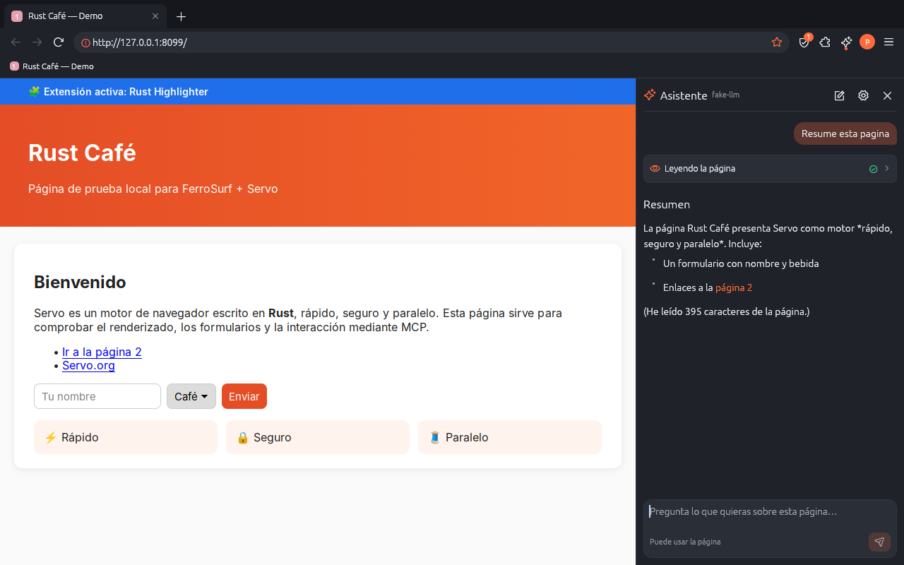
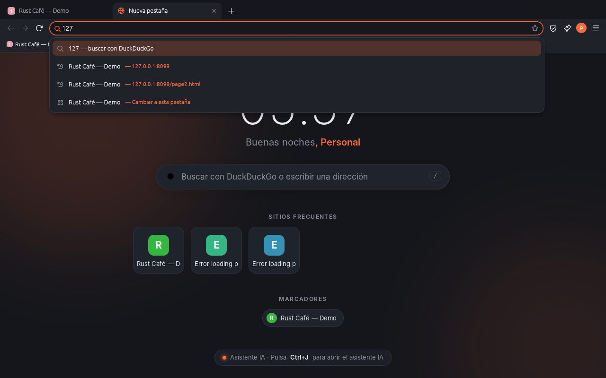
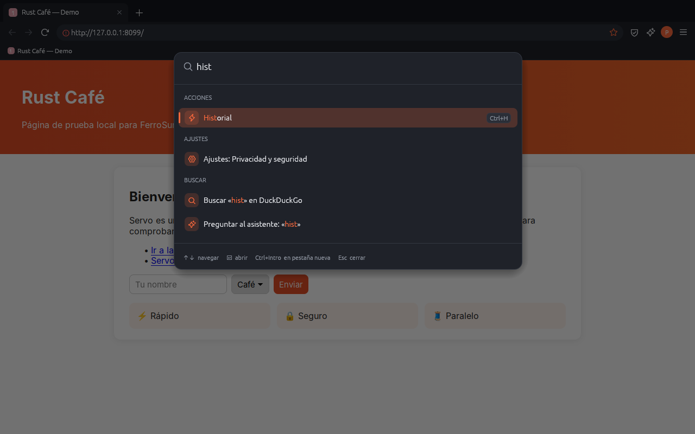
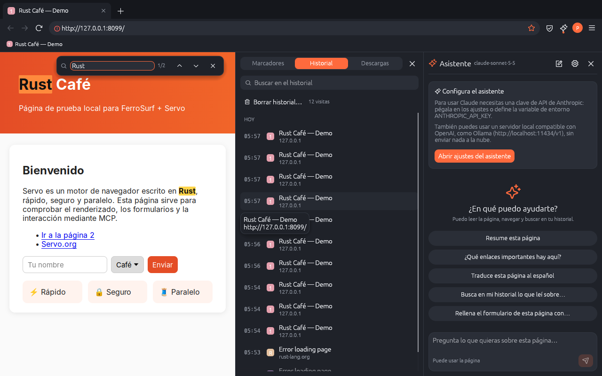
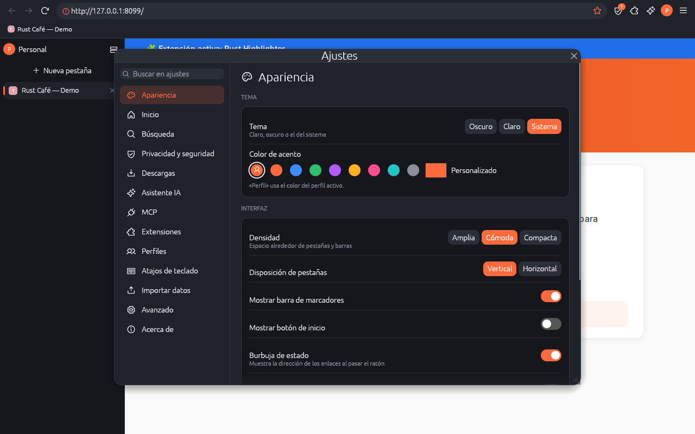
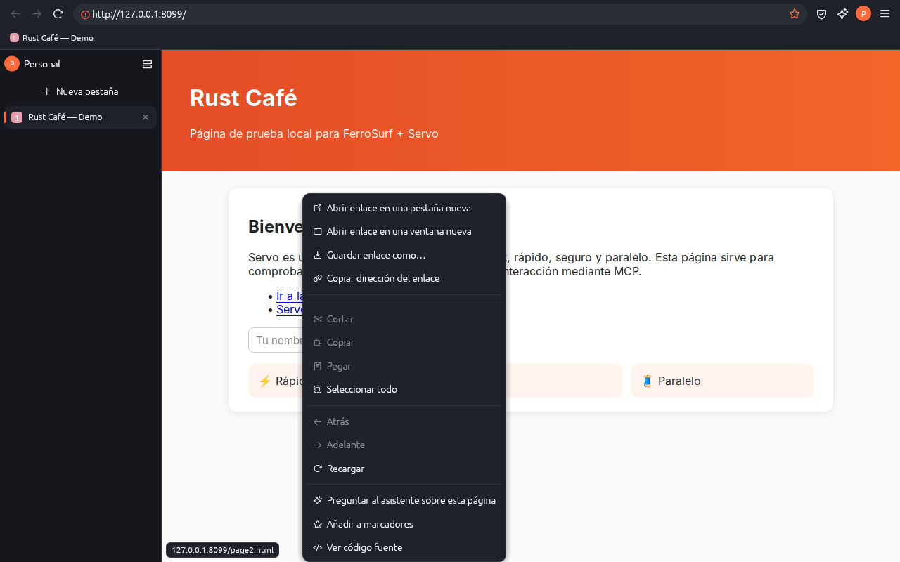
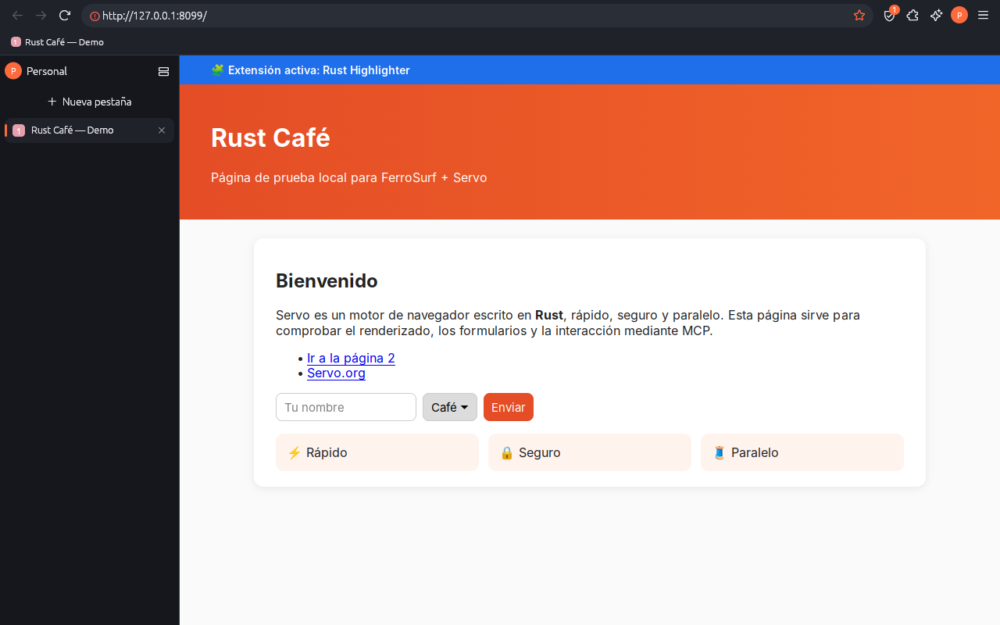

<p align="center">
  
</p>

<h1 align="center">FerroSurf</h1>

<p align="center"><b>Navegador web rápido, moderno y con IA nativa, escrito en Rust sobre el motor <a href="https://servo.org">Servo</a>.</b><br>
Windows · Linux · MCP integrado</p>

---

FerroSurf es la interfaz ("chrome") completa de un navegador construida alrededor de Servo 0.8:
pestañas, perfiles, marcadores, historial, descargas, extensiones, bloqueador de rastreadores,
asistente IA y **soporte nativo del Model Context Protocol (MCP)** tanto como servidor (los
agentes de IA pueden manejar el navegador) como cliente (el asistente puede usar tus servidores MCP).

<p align="center"></p>

| | |
|---|---|
|  |  |
|  |  |
|  |  |

*Capturas reales de FerroSurf renderizando con Servo (Linux, Xvfb).*

## Funciones

| Área | Qué incluye |
|---|---|
| **Pestañas** | Barra horizontal o **pestañas verticales**, arrastrar para reordenar, fijar, duplicar, cerrar otras/derecha, reabrir cerradas (Ctrl+Shift+T), **pestañas dormidas** que liberan memoria tras N minutos, restaurar sesión (las pestañas de fondo se restauran sin cargar). |
| **Barra de direcciones** | Sugerencias de historial (frecencia), marcadores, pestañas abiertas y del buscador; autocompletado en línea; palabras clave (`w rust`, `gh servo`, `yt …`); `>` para comandos; modo **solo HTTPS**. |
| **Marcadores** | Barra de marcadores con carpetas, gestor con árbol y arrastrar y soltar, etiquetas, importar/exportar HTML (formato Netscape). |
| **Historial** | SQLite con ranking por frecencia, agrupado por días, búsqueda y borrado por rangos. |
| **Descargas** | Gestor con pausa/reanudación (HTTP Range), reintentos, velocidad y tiempo restante, enlaces `data:`; usa las cookies del sitio. |
| **Perfiles múltiples** | Cada perfil es un directorio aislado (ajustes, marcadores, historial, extensiones, cookies y almacenamiento de Servo). Un proceso por perfil → aislamiento total. Perfil **invitado** efímero (`--guest`). |
| **Extensiones** | Subconjunto de WebExtensions (MV2/MV3): `content_scripts` (JS+CSS con `matches`/`run_at`), API `chrome.storage.local`/`runtime`/`i18n`, reglas `declarativeNetRequest`, `chrome_url_overrides.newtab`. Instalación desde carpeta (modo desarrollador), `.zip`, `.xpi` o `.crx`. |
| **Plugins nativos** | Plugins en Rust compilados a WebAssembly (sandbox `wasmi`, permisos por plugin, coste cero si están desactivados): bloquear/redirigir peticiones, scripts de página, comandos de la paleta, sugerencias en la barra de direcciones y herramientas MCP para el asistente. Ver [docs/plugins.md](docs/plugins.md). Las extensiones de Chrome/Firefox siguen funcionando como «legacy», instalables desde sus tiendas. |
| **Contraseñas y passkeys** | Integración con **Bitwarden** (CLI `bw`): rellenar usuario/contraseña, TOTP. **Passkeys (WebAuthn)** con permiso explícito en cada uso, guardadas en Bitwarden o cifradas en el perfil. |
| **Panel lateral** | Barra de paneles web a la derecha (traductor, chat, música, claude.ai…) que se abren junto a la página; Ctrl+J puede abrir un panel en lugar del asistente integrado. |
| **DevTools** | Herramientas de desarrollo integradas (F12): consola con REPL, inspector de elementos, red, almacenamiento y rendimiento. |
| **Privacidad** | Bloqueador de anuncios y rastreadores integrado (listas estilo Adblock Plus + DNR), Do-Not-Track, permisos por sitio, borrar datos de navegación. |
| **IA nativa** | Panel **Asistente** (Ctrl+J) con streaming, uso de herramientas y lectura/acción sobre la página; proveedores Anthropic (Claude) u OpenAI-compatible (Ollama, LM Studio, OpenRouter…). |
| **MCP** | Servidor MCP (Streamable HTTP en `127.0.0.1`, token Bearer) con 23 herramientas: pestañas, navegación, leer página, enlaces, clic, escribir, seleccionar, scroll, capturas, JS, historial y marcadores. Puente stdio (`ferrosurf --mcp-stdio`) para Claude Desktop/Code. Cliente MCP (stdio y HTTP) para el asistente. |
| **Personalización** | Tema claro/oscuro/sistema, color de acento, densidad, radio de esquinas, escala y tamaño de fuente, modo oscuro web, atajos de teclado editables. |
| **Productividad** | Paleta de comandos (Ctrl+K), buscar en página (Ctrl+F), zoom por sitio, pantalla completa, capturas, ver código fuente, importar desde Chrome/Edge/Brave/Vivaldi/Opera/Firefox/LibreWolf. |

## Instalar

**Linux (x86_64)** — instala o actualiza en tu carpeta personal, sin root:

```bash
curl -fsSL https://raw.githubusercontent.com/FerroApps/FerroSurf/main/install.sh | sh
```

Para desinstalar (no toca perfiles, marcadores ni historial):

```bash
curl -fsSL https://raw.githubusercontent.com/FerroApps/FerroSurf/main/install.sh | sh -s -- --uninstall
```

**Windows (x86_64)** — descarga `ferrosurf-v<versión>-windows-x86_64.zip` de la
[última release](https://github.com/FerroApps/FerroSurf/releases/latest), descomprímelo y ejecuta `ferrosurf.exe`.

Cada release incluye su `.sha256` para verificar la descarga.

## Compilar

Requisitos: Rust estable (≥ 1.88) y las dependencias de compilación de Servo.

**Linux (Debian/Ubuntu):**

```bash
sudo apt install build-essential clang llvm cmake python3 pkg-config libx11-dev libxkbcommon-dev libfontconfig1-dev libfreetype6-dev libgl1-mesa-dev libegl1-mesa-dev libwayland-dev libudev-dev libdbus-1-dev
```

**Windows:** Visual Studio Build Tools (C++), LLVM (`choco install llvm`) y MozillaBuild (ver `.github/workflows/ci.yml`).

```bash
cargo build --release -p ferrosurf
```

La primera compilación tarda (Servo + SpiderMonkey). Las siguientes son incrementales.

## Uso

```bash
ferrosurf [URL...]                 # abre URLs o búsquedas
ferrosurf --profile Trabajo        # perfil concreto (nombre o id)
ferrosurf --guest                  # ventana de invitado efímera
ferrosurf --mcp-stdio              # puente MCP por stdio hacia el navegador en ejecución
ferrosurf --load-extension ./mi-extension         # carga una extensión desempaquetada
ferrosurf --screenshot out.png https://servo.org   # captura y sale (útil para pruebas)
```

Si el perfil ya está abierto, las URLs se envían a la instancia en ejecución.

### Conectar un agente MCP (Claude Desktop / Claude Code)

```json
{
  "mcpServers": {
    "ferrosurf": { "command": "ferrosurf", "args": ["--mcp-stdio"] }
  }
}
```

O directamente por HTTP: la URL y el token se escriben en `<perfil>/mcp-endpoint.json`
(Ajustes → MCP muestra el fragmento listo para copiar).

### Atajos principales

| Atajo | Acción |
|---|---|
| Ctrl+T / Ctrl+W / Ctrl+Shift+T | Nueva / cerrar / reabrir pestaña |
| Ctrl+L, Alt+D, F6 | Barra de direcciones |
| Ctrl+K | Paleta de comandos |
| Ctrl+J | Asistente IA |
| Ctrl+F | Buscar en la página |
| Ctrl+D / Ctrl+Shift+B | Añadir marcador / barra de marcadores |
| Ctrl+H / Ctrl+Shift+Y | Historial / descargas |
| Ctrl+Shift+V | Pestañas verticales |
| Ctrl+ + / − / 0 | Zoom |
| Ctrl+, | Ajustes |

Todos se pueden cambiar en Ajustes → Atajos de teclado.

## Arquitectura

```
crates/
  ferrosurf-core/        perfiles, ajustes, marcadores, historial (SQLite), sesión,
                         descargas, permisos, búsqueda, omnibox, importadores
  ferrosurf-extensions/  manifiestos, match patterns, content scripts, bloqueador (ABP + DNR)
  ferrosurf-plugins/     host de plugins nativos (WebAssembly en wasmi, permisos, MCP)
  ferrosurf-plugin-sdk/  SDK para escribir plugins en Rust
  ferrosurf-passwords/   cliente de Bitwarden, polyfill WebAuthn y autenticador de passkeys
  ferrosurf-mcp/         JSON-RPC, servidor MCP HTTP + puente stdio, cliente MCP,
                         herramientas del navegador, bucle del asistente (Anthropic/OpenAI)
  ferrosurf/             la app: winit + egui (chrome) + Servo (contenido), páginas ferro://
```

- **Render:** Servo pinta cada pestaña en un `OffscreenRenderingContext`; egui dibuja la interfaz
  y compone el framebuffer de Servo en el área de contenido mediante un *paint callback* de GL.
- **Hilos:** Servo vive en el hilo principal. El servidor MCP, el asistente y las descargas corren
  en un runtime Tokio y se comunican con la UI por canales + `EventLoopProxy`.
- **Páginas internas:** `ferro://newtab`, `ferro://about`, `ferro://error` se sirven con un
  `ProtocolHandler` propio; `ferro-extension://<id>/` sirve recursos de extensiones.

## Datos

- Linux: `~/.local/share/FerroSurf/` · Windows: `%APPDATA%\FerroApps\FerroSurf\data\`
- Modo portátil: `--data-dir <ruta>` o `FERROSURF_HOME`.

## Versiones y releases

La versión vive en `Cargo.toml` y la sube el workflow **Version**: cada push a
`development` incrementa el *patch*, y cada fusión `development → main` el *minor*.
Tras cada subida en `main`, **Release** compila y publica `ferrosurf-v<ver>-linux-x86_64.tar.gz`
y `ferrosurf-v<ver>-windows-x86_64.zip` (con sus `.sha256`).

## Licencia

MIT. Servo y sus componentes se distribuyen bajo MPL-2.0.
